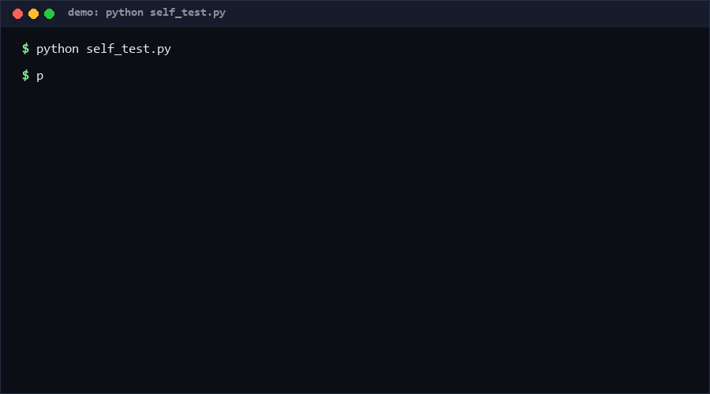

# agent-audit-trail

An append-only, hash-chained JSONL audit trail for AI agents: every decision, tool call, rollback, and checkpoint becomes one line whose `hash` commits to its entire history, so any tamper, deletion, reorder, or gap in the log is detectable with one `verify` command. Drop it behind your agent's tool-execution loop and "what exactly did the agent do?" becomes a replayable file question, not a memory contest.

**Confidence: High (85%)** that the four event types plus rollback linkage cover the audit-relevant moments of a tool-using agent loop; **Medium (55%)** that SHA-256 chaining alone is the right trust model for your threat model — it detects *post-hoc* tampering but proves nothing about the appender [estimated].

<p align="center"></p>

## Problem

Agents take consequential actions, then the story of *why* lives in scrollback. When an audit, a postmortem, or an angry user asks "which decision led to that deletion?", teams discover their logs are editable text with no integrity property. The adjacent ecosystem knows this: wdh107/agent-audit-trail (4★ as of 2026-10-11) ships a spec + reference SDK centered on recording decision chains, kanson1996/agent-audit-trail (4★) generates hash-chained JSONL for tamper-evidence, and sunh3997-eng/AgentAuditTrail (0★) is a full audit platform — all anchor the same need, but none combines a *validated event-type schema* (rollback events must point at the event they undo) with gap/reorder discrimination in a single-file, zero-dependency implementation. That combination is this repo.

## How it works

One JSON object per line:

```json
{"seq": 2, "ts": "2026-10-11T00:00:00+00:00", "type": "tool_call",
 "payload": {"tool": "bash"}, "prev_hash": "ab12…", "hash": "9f3e…"}
```

- `hash = sha256(prev_hash + canonical_json(event_without_hash))` — canonical JSON (sorted keys, no whitespace) makes hashes reproducible across languages.
- Event types: `decision`, `tool_call`, `rollback`, `checkpoint`. A `rollback` must carry `ref` pointing at an earlier seq — the trail records *what was undone*, not just that something was.
- `verify` walks the file and discriminates failure modes: hash mismatch (payload edited after append), prev_hash mismatch (reorder/deletion), sequence gap or duplicate seq (line removed or duplicated), unknown type (schema drift), unparseable line (corruption) — each reported per-seq, never crashing on malformed input.
- Exit discipline: `verify` exits 0 clean, 1 violated, 2 usage.

## Quickstart (~2 min)

```bash
# 1. Self-test: 44 checks, functional / error-path / extreme-edge (~2 s)
python self_test.py

# 2. Record an agent loop
python cli.py append trail.jsonl --type decision  --payload '{"action":"deploy"}'
python cli.py append trail.jsonl --type tool_call --payload '{"tool":"bash"}'
python cli.py append trail.jsonl --type rollback  --payload '{"reason":"bad"}' --ref 1

# 3. Audit it
python cli.py verify trail.jsonl          # valid: true | events: 3 | errors: 0
python cli.py stats trail.jsonl           # per-type counts
python cli.py extract trail.jsonl --type rollback
```

## Why not X

| Alternative | Why not |
|---|---|
| wdh107/agent-audit-trail (4★) | Spec + SDK for *recording* decision chains; no hash-chain integrity verification and no rollback-linkage rule |
| kanson1996/agent-audit-trail (4★) | Hash-chained JSONL for tamper-evidence, but treats the log as opaque records — no event-type schema validation, no gap-vs-reorder discrimination, no rollback ref integrity |
| sunh3997-eng/AgentAuditTrail (0★) | A platform (deploy a service); this is a file format + CLI you can adopt in one command with zero infrastructure |
| Plain `logging` / log files | Editable without detection, no ordering guarantees, no machine-checkable linkage between a rollback and its target |
| Blockchain-style anchoring | Solves distributed trust you don't have; a local agent needs local tamper-evidence, which one sha256 chain already provides |

## Minimal Fallback (PLAN B)

No Python? The spec is one paragraph: JSONL, gapless 1-based `seq`, `hash = sha256(prev_hash + sorted-keys-json(everything-but-hash))`, four types, rollback requires `ref` to an earlier seq. Any language's `hashlib`-equivalent reproduces it; the canonical-JSON recipe above is the interop contract, and a verifier is ~40 lines in any runtime.

## Design Trade-offs

Priority order: **verifiability > expressiveness > throughput**. The payload is free-form JSON — semantics stay out of the format, so this can't answer "was the decision *good*?", only "was the record *touched*?". Hash chaining is linear: verifying requires reading the whole file (O(n)); we accept that because audit is a batch operation, not a hot path. Timestamps are caller-supplied and hashed but never validated against a clock — a lying appender can backdate, and no local format can fix that. Rollback `ref` points to a seq, not a hash, keeping the file human-greppable at the cost of not proving the rollback saw that exact event version.

## Limits & Second-order Effects

- Tamper-*evident*, not tamper-*proof*: anyone who can rewrite the file can recompute the whole chain; for hostile-appenders you need external anchoring (e.g. periodically hash the head into something you don't control).
- Because every event is hashed into its successors, you can never redact, truncate, or GDPR-erase a line — privacy-sensitive payloads must be minimized *before* append, not after.
- The four-type schema will chafe; teams will smuggle semantics into `payload`, eroding `stats`/`extract` usefulness — schema evolution is deliberately a breaking change to force conscious migration.
- High-frequency tool calls make big files fast; `verify` cost grows linearly and will become the excuse for skipping verification.

## FAQ

**Can I delete an event I regret?** No — that's the point. Append a compensating `rollback` event instead.

**Is the hash chain portable across languages?** Yes, if implementations agree on canonical JSON: sorted keys, `,`/`:` separators, UTF-8, no whitespace. That recipe is the entire interop surface.

**When NOT to use this?** Don't use it where the appender itself is untrusted (it can rechain lies); don't use it for PII-heavy payloads (nothing can ever be redacted); and don't use it as a *security* boundary — it answers "was the log edited?", not "was the agent authorized?".

**Why seq + prev_hash both?** Redundancy is the feature: seq catches silent line *deletion* (gap), prev_hash catches *reordering* — either alone misses one of the two.

## [Core Assumptions]

1. The appender (the agent harness) is more trusted than later editors of the file; the threat model is post-hoc tampering, not live forgery.
2. Four event types plus rollback linkage are sufficient audit granularity for tool-using agents; finer semantics belong in payload.
3. Canonical JSON (sorted keys, fixed separators, UTF-8) is a stable cross-language recipe for reproducible hashes.
4. Linear full-file verification is an acceptable cost because audits are batch operations.

*Data as of 2026-10-11. Measured: 44/44 self-test checks PASS (functional 16, error paths 10, extreme edges 18), repro `python self_test.py` on Windows 10 / CPython 3.11. Threat-model adequacy (chaining vs hostile appenders) is [estimated].*

---

Part of the [zhengming-toolbox](https://github.com/chenhz01/zhengming-toolbox) — 55 purpose-built AI-engineering tools across neglected niches.

Related tools: [tool-call-replay](https://github.com/chenhz01/tool-call-replay) · [model-capability-matrix](https://github.com/chenhz01/model-capability-matrix) · [model-arbitration-spec](https://github.com/chenhz01/model-arbitration-spec)
